# ForgeOps

A self-hosted deployment platform. Connect a GitHub repository, click Deploy, and ForgeOps builds it, runs it in
its own container and gives it a live HTTPS link. If a deploy fails it shows which step broke and why. If an app
breaks after going live, it rolls back to the last working version on its own.

## Architecture

```mermaid
%%{init: {"theme": "dark", "themeVariables": {"darkMode": true, "background": "#0d1117", "fontFamily": "Inter, Helvetica, Arial, sans-serif", "fontSize": "15px", "primaryTextColor": "#e6edf3", "textColor": "#e6edf3", "titleColor": "#e6edf3", "lineColor": "#8b949e", "clusterBkg": "#161b22", "clusterBorder": "#30363d", "edgeLabelBackground": "#161b22"}, "flowchart": {"curve": "basis", "nodeSpacing": 45, "rankSpacing": 60}}}%%
flowchart TB
    subgraph CANVAS[" "]
        direction TB
        dev(["Developer"]):::person
        visitor(["Visitor of a deployed app"]):::person

        subgraph EXT["Outside services"]
            direction LR
            github["GitHub<br/>user repos · App · OAuth"]:::ext
            mail["Email"]:::ext
            slack["Slack"]:::ext
        end

        subgraph HOST["AWS EC2 server, built with Terraform"]
            direction TB

            subgraph CP["Control plane: ForgeOps itself"]
                direction LR
                web["Dashboard<br/>React · Vite · Tailwind"]:::built
                api["API<br/>Express modular monolith<br/>auth · projects · deployments<br/>github · alerts"]:::built
                pg[("PostgreSQL<br/>source of truth<br/>+ outbox")]:::data
                mq[["RabbitMQ<br/>jobs + dead-letter"]]:::data
                worker["Worker<br/>deploy pipeline · health watch<br/>metrics · logs · alerts"]:::built
            end

            subgraph WP["Workload plane: where users' apps run"]
                direction LR
                reg[("Image registry<br/>image + digest")]:::data
                router["Caddy router<br/>HTTPS · one URL per service"]:::built
                ctr["App containers<br/>Docker"]:::built
            end
        end

        dev --> web --> api
        api -->|"save intent + outbox<br/>in one transaction"| pg
        pg -->|"relay"| mq -->|"job"| worker
        worker -->|"status, steps"| pg
        api <-->|"repos, sign-in"| github
        worker -->|"clone at a pinned commit"| github
        worker -->|"build, push"| reg
        worker -->|"run + add route"| router
        router --> ctr
        visitor --> router
        worker -->|"failure alerts"| mail
        worker -->|"failure alerts"| slack
    end

    classDef built fill:#12261e,stroke:#3fb950,stroke-width:2px,color:#e6edf3
    classDef data fill:#0c2d48,stroke:#58a6ff,stroke-width:2px,color:#e6edf3
    classDef ext fill:#21262d,stroke:#8b949e,stroke-width:1.5px,color:#e6edf3
    classDef person fill:#2d2410,stroke:#d29922,stroke-width:2px,color:#e6edf3
    style HOST fill:#1a120b,stroke:#f0883e,stroke-width:2px,color:#e6edf3
    style CP fill:#0f1a14,stroke:#3fb950,stroke-width:1.5px,color:#e6edf3
    style WP fill:#0f1a14,stroke:#3fb950,stroke-width:1.5px,color:#e6edf3
    style EXT fill:#161b22,stroke:#30363d,color:#e6edf3
    style CANVAS fill:#0d1117,stroke:#0d1117
```



## What happens when you click Deploy

1. The API saves the deployment and an **outbox** row in one database transaction and answers `202 Accepted` at
   once. If RabbitMQ is down, the job waits safely in PostgreSQL.
2. The worker publishes the job to **RabbitMQ** and waits for the broker to confirm it.
3. One worker claims the job. A duplicate message cannot start a second deploy.
4. The worker runs seven steps: pin the exact commit, fetch the code, build the Docker image, push it to the
   registry, start the container, check its health endpoint, then route the URL to it.
5. If the health check fails, the new container is removed and the old version keeps serving. You get an email or
   Slack alert with the failing step and the app's log.
6. After go-live the worker keeps watching. Three failed checks in a row or a crash trigger an automatic rollback to
   the last good image.

Build, rollout and health are separate outcomes: an image can build and still fail to start, and an app can start
and still break later.

## Features

- Accounts, organisations and projects; every request is checked against the user's organisation
- GitHub App integration: pick a repository and branch, deploy any commit
- Web services with their own HTTPS URL
- Per-deploy step logs, app logs, CPU and memory metrics
- Manual and automatic rollback
- Environment variables encrypted with AES-256-GCM
- Email and Slack alerts on failure
- Rate limiting on the API, sign-up and login

## Stack

| Part | Tools |
| --- | --- |
| Frontend | React, Vite, TypeScript, Tailwind |
| Backend | Node.js, Express, TypeScript, Prisma |
| Data | PostgreSQL, RabbitMQ |
| Runtime | Docker, Docker Compose, Caddy |
| CI/CD | GitHub Actions, Trivy, CodeQL, gitleaks, GHCR |
| Cloud | AWS (VPC, EC2, IAM, Parameter Store), Terraform |

```
apps/
  api/          Express API and the deployment worker
  frontend/     React dashboard
caddy/          local router config
infra/aws/      Terraform for the AWS server
  server/       production compose file, Caddy config and boot script
```

## Run it locally

You need [nvm](https://github.com/nvm-sh/nvm) (Node 24 is pinned in `.nvmrc`) and Docker Desktop.

```bash
nvm install && nvm use
corepack enable
pnpm install
cp apps/api/.env.example apps/api/.env
mkdir -p ~/.forgeops && chmod 700 ~/.forgeops
(umask 077 && openssl rand -base64 32 > ~/.forgeops/env-encryption.key)
docker compose up -d
pnpm --filter @forgeops/api exec prisma migrate dev
```

Set `ENCRYPTION_KEY_PATH` in `apps/api/.env` to the full path of that key file. To connect repositories, fill in
the `GITHUB_APP_*` and `GITHUB_CLIENT_*` values from your own GitHub App. Keep key files outside the repo and put
only their paths in `.env`.

Then, in three terminals (run `nvm use` in each):

```bash
pnpm --filter @forgeops/api dev
pnpm --filter @forgeops/api worker
pnpm --filter @forgeops/frontend dev
```

Open http://localhost:5173. Deployed services are served at `http://<service>.<project>.localhost`.

| Service | Address |
| --- | --- |
| Dashboard | http://localhost:5173 |
| API | http://localhost:4000 (`/health/live`, `/health/ready`) |
| PostgreSQL | `127.0.0.1:5433` |
| RabbitMQ | `127.0.0.1:5673`, management UI http://localhost:15673 |
| Image registry | `localhost:5001` |
| Caddy router | port 80, admin API `127.0.0.1:2019` |

## Run it on AWS

Terraform in `infra/aws/` builds a VPC with one public subnet, a security group (80 and 443 open, SSH from one IP),
an IAM role that can read only ForgeOps' secrets from Parameter Store, and one EC2 server. On first boot the server
installs Docker, fetches its secrets and starts the stack from the images CI pushed to GHCR. Caddy gets Let's
Encrypt certificates for `sslip.io` names, so HTTPS works without buying a domain.

```bash
aws ssm put-parameter --region us-east-2 --name /forgeops/encryption-key --type SecureString --value file://$HOME/.forgeops/env-encryption.key
aws ssm put-parameter --region us-east-2 --name /forgeops/github-app-key --type SecureString --value file://$HOME/.forgeops/github-app.pem
aws ssm put-parameter --region us-east-2 --name /forgeops/github-client-secret --type SecureString --value file://$HOME/.forgeops/github-client-secret
cd infra/aws
terraform init
terraform apply
terraform destroy
```

`terraform.tfvars` (not committed) sets `ssh_cidr`, `release` (a commit on main) and the GitHub App IDs. The
dashboard URL is printed after `apply`.

## Checks

```bash
pnpm test
pnpm typecheck
pnpm lint
pnpm format:check
```

The tests run against real PostgreSQL, RabbitMQ, Docker and Caddy, so `docker compose up -d` must be running.
