# ForgeOps

A reliability-first deployment platform: connect a GitHub repository, deploy web services, workers and
scheduled jobs, see what broke and roll back. Portfolio project; see [docs/PRODUCT.md](docs/PRODUCT.md).

**Status:** milestone M1 works end to end on one machine: sign up, connect GitHub, deploy, watch health,
roll back, get alerts. CI/CD runs on GitHub Actions. Next: AWS with Terraform (phase 8), then Kubernetes
(phase 9). Progress is tracked in [docs/CURRENT.md](docs/CURRENT.md).

## Architecture

```mermaid
%%{init: {"theme": "dark", "themeVariables": {"darkMode": true, "background": "#0d1117", "fontFamily": "Inter, Helvetica, Arial, sans-serif", "fontSize": "15px", "primaryTextColor": "#e6edf3", "textColor": "#e6edf3", "titleColor": "#e6edf3", "lineColor": "#8b949e", "clusterBkg": "#161b22", "clusterBorder": "#30363d", "edgeLabelBackground": "#161b22"}, "flowchart": {"curve": "basis", "nodeSpacing": 45, "rankSpacing": 60}}}%%
flowchart TB
    subgraph CANVAS[" "]
        direction TB
        dev(["Developer"]):::person
        visitor(["Visitor of a deployed app"]):::person

        subgraph EXT["Outside services"]
            direction LR
            github["GitHub<br/>user repos · App · OAuth"]:::ext
            mail["Email"]:::ext
            slack["Slack"]:::ext
        end

        subgraph HOST["Host: laptop now, AWS EC2 later"]
            direction TB

            subgraph CP["Control plane: ForgeOps itself"]
                direction LR
                web["Dashboard<br/>React · Vite · Tailwind<br/>served by Caddy"]:::built
                api["API<br/>Express modular monolith<br/>auth · projects · deployments<br/>github · alerts"]:::built
                pg[("PostgreSQL<br/>source of truth<br/>+ outbox")]:::data
                mq[["RabbitMQ<br/>jobs + dead-letter"]]:::data
                worker["Worker<br/>deploy pipeline · health watch<br/>metrics · logs · alerts"]:::built
            end

            subgraph WP["Workload plane: where users' apps run"]
                direction LR
                reg[("Image registry<br/>image + digest")]:::data
                subgraph NOW["Today"]
                    router["Caddy router<br/>one URL per service"]:::built
                    ctr["App containers<br/>plain Docker"]:::built
                end
                subgraph K8S["Phase 9"]
                    ingress["Ingress controller"]:::k8s
                    pods["Kubernetes<br/>Deployments · Services · Jobs<br/>one namespace per org"]:::k8s
                end
            end
        end

        dev --> web --> api
        api -->|"save intent + outbox<br/>in one transaction"| pg
        pg -->|"relay"| mq -->|"job"| worker
        worker -->|"status, steps"| pg
        api <-->|"repos, sign-in"| github
        worker -->|"clone at a pinned commit"| github
        worker -->|"build, push"| reg
        worker -->|"run + add route"| router
        router --> ctr
        worker -.->|"apply manifests"| pods
        visitor --> router
        visitor -.-> ingress -.-> pods
        worker -->|"failure alerts"| mail
        worker -->|"failure alerts"| slack
    end

    classDef built fill:#12261e,stroke:#3fb950,stroke-width:2px,color:#e6edf3
    classDef data fill:#0c2d48,stroke:#58a6ff,stroke-width:2px,color:#e6edf3
    classDef ext fill:#21262d,stroke:#8b949e,stroke-width:1.5px,color:#e6edf3
    classDef person fill:#2d2410,stroke:#d29922,stroke-width:2px,color:#e6edf3
    classDef k8s fill:#1f1638,stroke:#a371f7,stroke-width:2px,stroke-dasharray:6 4,color:#e6edf3
    style HOST fill:#1a120b,stroke:#f0883e,stroke-width:2px,stroke-dasharray:6 4,color:#e6edf3
    style CP fill:#0f1a14,stroke:#3fb950,stroke-width:1.5px,color:#e6edf3
    style WP fill:#0f1a14,stroke:#3fb950,stroke-width:1.5px,color:#e6edf3
    style NOW fill:#12261e,stroke:#3fb950,color:#e6edf3
    style K8S fill:#1a1430,stroke:#a371f7,stroke-dasharray:6 4,color:#e6edf3
    style EXT fill:#161b22,stroke:#30363d,color:#e6edf3
    style CANVAS fill:#0d1117,stroke:#0d1117
```



Green is built today. Dashed orange is the AWS plan, dashed purple is the Kubernetes plan. All four
diagrams (deploy timeline, CI to AWS, Kubernetes) are in [docs/diagrams/forgeops.md](docs/diagrams/forgeops.md).

### How it works

1. **You click Deploy** in the dashboard. The API saves the deployment and an **outbox** row in one database
   transaction, then answers `202 Accepted` straight away.
2. **The worker hands the job over safely.** It reads the outbox and publishes the job to **RabbitMQ**, waiting
   for the broker to confirm. If RabbitMQ is down, the job waits in PostgreSQL, so it is never lost.
3. **One worker claims the job.** A duplicate delivery cannot start a second deploy (idempotent worker).
4. **The worker runs 7 steps:** pin the exact commit, fetch the code from GitHub, build the Docker image, push it
   to the registry (recording its digest), start a container, check `/health/ready`, then route the URL to it.
5. **If the health check fails,** the new container is removed and the old version keeps serving. You get an
   email or Slack alert with the failing step and the app's log.
6. **After go-live the worker keeps watching.** Three failed health checks in a row trigger an automatic
   rollback to the last good image. You can also roll back by hand from the history.

**Two planes.** The **control plane** (dashboard, API, PostgreSQL, RabbitMQ, worker) decides what should run.
The **workload plane** (registry, Caddy router, app containers) actually runs the users' apps. Phase 9
replaces the workload plane with Kubernetes; the pipeline stays the same.

**Three outcomes kept apart:** build (is there an image?), rollout (did it start and pass health?), health
(does it stay working?).

## Stack

React + Vite · Node.js + Express + TypeScript · PostgreSQL + Prisma · pnpm monorepo · Docker Compose.
Every technical decision and its trade-offs: [docs/DECISIONS.md](docs/DECISIONS.md).

```
apps/
  api/        Express API (port 4000)
  frontend/   React dashboard (port 5173)
docs/         product, architecture, roadmap, decisions, issues
```

## Prerequisites

- [nvm](https://github.com/nvm-sh/nvm) (the repo pins Node 24 in `.nvmrc`)
- Docker Desktop
- pnpm, enabled through Node's corepack (step 2 below)

## Setup

```bash
nvm install && nvm use
corepack enable
pnpm install
cp apps/api/.env.example apps/api/.env
mkdir -p ~/.forgeops && chmod 700 ~/.forgeops
(umask 077 && openssl rand -base64 32 > ~/.forgeops/env-encryption.key)
docker compose up -d
pnpm --filter @forgeops/api exec prisma migrate dev
```

Optional demo data, safe to rerun after the local database is reset: set `SEED_GITHUB_INSTALLATION_ID` in
`apps/api/.env`, then run `pnpm --filter @forgeops/api seed`. It creates `demo@forgeops.test` (password saved in
`~/.forgeops/demo-password`), links the GitHub installation and adds the sample project and service.

Set `ENCRYPTION_KEY_PATH` in `apps/api/.env` to the full path of that key file (it encrypts service env vars; losing
it loses the stored values). GitHub settings are optional: fill in the `GITHUB_APP_*` values from your GitHub App
to connect repositories, and `GITHUB_CLIENT_ID` / `GITHUB_CLIENT_SECRET_PATH` to verify installations through
GitHub sign-in. Keep key files outside the repo and put only their paths in `.env`. `RABBITMQ_URL`,
`REGISTRY_HOST` and `TEST_REGISTRY_HOST` (already in `.env.example`) are needed by the deployment worker and the tests, which also need
Docker running.

## Run

In three terminals (run `nvm use` in each):

```bash
pnpm --filter @forgeops/api dev
pnpm --filter @forgeops/api worker
pnpm --filter @forgeops/frontend dev
```

The worker sends queued deployments to RabbitMQ and runs them: it downloads the commit, builds the image with this
machine's Docker, pushes it to the local registry, runs it as a container and routes
`http://<service>.<project>.localhost` to it through Caddy. It needs the GitHub App settings, Docker and
`docker compose up -d` (Caddy and the `forgeops-apps` network), and exits if it loses its RabbitMQ connection; start
it again and unfinished messages are redelivered.

Open http://localhost:5173. The frontend forwards `/api` and `/health` requests to the API.

| Service | Address |
| --- | --- |
| Dashboard | http://localhost:5173 |
| API | http://localhost:4000 (`/health/live`, `/health/ready`) |
| PostgreSQL | `127.0.0.1:5433`, user / password / database: `forgeops` (local only) |
| RabbitMQ | `127.0.0.1:5673`, management UI http://localhost:15673, user / password: `forgeops` (local only) |
| Image registry | `localhost:5001` (`curl localhost:5001/v2/_catalog` lists images; local only, no login) |
| Test image registry | `localhost:5002`, used only by the tests; in memory, emptied on restart |
| Deployed services | `http://<service>.<project>.localhost` (Caddy on port 80; unknown names get 404) |
| Caddy admin API | `127.0.0.1:2019` (no auth, local only); test Caddy: admin `127.0.0.1:2020`, HTTP `127.0.0.1:8081` |

## Checks

```bash
pnpm test
pnpm typecheck
pnpm lint
pnpm format:check
```

## Troubleshooting

- **Port 5432 already in use:** expected if you run another PostgreSQL. ForgeOps uses 5433.
- **First `docker compose up` is slow:** PostgreSQL initialises its data on first start (can take ~30 s on
  Docker Desktop for Mac). Later starts take seconds.
- **`Cannot find module .../generated/prisma/client.js`:** run `pnpm --filter @forgeops/api exec prisma generate`.
- **`Invalid configuration`:** a setting in `apps/api/.env` is missing or wrong; the message names which one.
- **Stop everything:** `docker compose stop` (keeps data) or `docker compose down -v` (deletes data).
