# ForgeOps architecture

Colour key, used in every diagram:

| Colour | Meaning |
| --- | --- |
| Green, solid border | Built and working today |
| Orange, dashed border | Planned, phase 8: AWS and Terraform (ADR-092, accepted) |
| Purple, dashed border | Planned, phase 9: Kubernetes (ADR-010, proposed) |
| Blue | Data: databases, queues, image stores |
| Grey | Outside services: GitHub, email, Slack |
| Yellow | People |

Every diagram sits on a black canvas, in GitHub's light and dark modes.

Contents:

1. [The big picture](#1-the-big-picture)
2. [What happens when you click Deploy](#2-what-happens-when-you-click-deploy)
3. [From a merge to the AWS server](#3-from-a-merge-to-the-aws-server)
4. [Kubernetes target](#4-kubernetes-target)

## 1. The big picture

```mermaid
%%{init: {"theme": "dark", "themeVariables": {"darkMode": true, "background": "#0d1117", "fontFamily": "Inter, Helvetica, Arial, sans-serif", "fontSize": "15px", "primaryTextColor": "#e6edf3", "textColor": "#e6edf3", "titleColor": "#e6edf3", "lineColor": "#8b949e", "clusterBkg": "#161b22", "clusterBorder": "#30363d", "edgeLabelBackground": "#161b22"}, "flowchart": {"curve": "basis", "nodeSpacing": 45, "rankSpacing": 60}}}%%
flowchart TB
    subgraph CANVAS[" "]
        direction TB
        dev(["Developer"]):::person
        visitor(["Visitor of a deployed app"]):::person

        subgraph EXT["Outside services"]
            direction LR
            github["GitHub<br/>user repos · App · OAuth"]:::ext
            mail["Email"]:::ext
            slack["Slack"]:::ext
        end

        subgraph HOST["Host: laptop now, AWS EC2 later"]
            direction TB

            subgraph CP["Control plane: ForgeOps itself"]
                direction LR
                web["Dashboard<br/>React · Vite · Tailwind<br/>served by Caddy"]:::built
                api["API<br/>Express modular monolith<br/>auth · projects · deployments<br/>github · alerts"]:::built
                pg[("PostgreSQL<br/>source of truth<br/>+ outbox")]:::data
                mq[["RabbitMQ<br/>jobs + dead-letter"]]:::data
                worker["Worker<br/>deploy pipeline · health watch<br/>metrics · logs · alerts"]:::built
            end

            subgraph WP["Workload plane: where users' apps run"]
                direction LR
                reg[("Image registry<br/>image + digest")]:::data
                subgraph NOW["Today"]
                    router["Caddy router<br/>one URL per service"]:::built
                    ctr["App containers<br/>plain Docker"]:::built
                end
                subgraph K8S["Phase 9"]
                    ingress["Ingress controller"]:::k8s
                    pods["Kubernetes<br/>Deployments · Services · Jobs<br/>one namespace per org"]:::k8s
                end
            end
        end

        dev --> web --> api
        api -->|"save intent + outbox<br/>in one transaction"| pg
        pg -->|"relay"| mq -->|"job"| worker
        worker -->|"status, steps"| pg
        api <-->|"repos, sign-in"| github
        worker -->|"clone at a pinned commit"| github
        worker -->|"build, push"| reg
        worker -->|"run + add route"| router
        router --> ctr
        worker -.->|"apply manifests"| pods
        visitor --> router
        visitor -.-> ingress -.-> pods
        worker -->|"failure alerts"| mail
        worker -->|"failure alerts"| slack
    end

    classDef built fill:#12261e,stroke:#3fb950,stroke-width:2px,color:#e6edf3
    classDef data fill:#0c2d48,stroke:#58a6ff,stroke-width:2px,color:#e6edf3
    classDef ext fill:#21262d,stroke:#8b949e,stroke-width:1.5px,color:#e6edf3
    classDef person fill:#2d2410,stroke:#d29922,stroke-width:2px,color:#e6edf3
    classDef k8s fill:#1f1638,stroke:#a371f7,stroke-width:2px,stroke-dasharray:6 4,color:#e6edf3
    style HOST fill:#1a120b,stroke:#f0883e,stroke-width:2px,stroke-dasharray:6 4,color:#e6edf3
    style CP fill:#0f1a14,stroke:#3fb950,stroke-width:1.5px,color:#e6edf3
    style WP fill:#0f1a14,stroke:#3fb950,stroke-width:1.5px,color:#e6edf3
    style NOW fill:#12261e,stroke:#3fb950,color:#e6edf3
    style K8S fill:#1a1430,stroke:#a371f7,stroke-dasharray:6 4,color:#e6edf3
    style EXT fill:#161b22,stroke:#30363d,color:#e6edf3
    style CANVAS fill:#0d1117,stroke:#0d1117
```

How to read it, top to bottom:

- **Control plane** decides what should run. **Workload plane** actually runs the users' apps.
- The API only saves the intent and answers fast. The worker does the slow work in the background.
- PostgreSQL is the source of truth. The outbox row is saved with the deployment in one transaction, so no
  job is lost if RabbitMQ is down.
- Phase 9 swaps the right-hand box: plain Docker and the Caddy router become Kubernetes and an ingress.
  The pipeline stays the same.

## 2. What happens when you click Deploy

```mermaid
%%{init: {"theme": "dark", "themeVariables": {"darkMode": true, "background": "#0d1117", "fontFamily": "Inter, Helvetica, Arial, sans-serif", "fontSize": "14px", "actorBkg": "#12261e", "actorBorder": "#3fb950", "actorTextColor": "#e6edf3", "actorLineColor": "#30363d", "signalColor": "#c9d1d9", "signalTextColor": "#e6edf3", "noteBkgColor": "#2d2410", "noteTextColor": "#e6edf3", "noteBorderColor": "#d29922", "labelBoxBkgColor": "#161b22", "labelBoxBorderColor": "#30363d", "labelTextColor": "#e6edf3", "loopTextColor": "#e6edf3", "activationBkgColor": "#0c2d48", "activationBorderColor": "#58a6ff", "sequenceNumberColor": "#0d1117"}}}%%
sequenceDiagram
    autonumber
    actor Dev as Developer
    participant API as API
    participant DB as PostgreSQL
    participant Q as RabbitMQ
    participant W as Worker
    participant GH as GitHub
    participant R as Registry
    participant App as New container
    participant C as Caddy router

    rect rgb(13, 17, 23)
        rect rgba(88, 166, 255, 0.14)
        Note over Dev,DB: Accept the request fast
        Dev->>API: POST /deployments with an Idempotency-Key
        API->>DB: deployment "queued" + outbox row, one transaction
        API-->>Dev: 202 Accepted
        end

        rect rgba(210, 153, 34, 0.14)
        Note over DB,W: Hand the job over safely
        W->>DB: read the outbox
        W->>Q: publish, wait for the broker's confirm
        Q->>W: deliver the job
        W->>DB: claim the deployment, only one worker wins
        end

        rect rgba(63, 185, 80, 0.14)
        Note over W,C: Run the 7 steps
        W->>GH: 1 resolve-commit, pin the exact SHA
        W->>GH: 2 fetch-source
        W->>W: 3 build from the Dockerfile
        W->>R: 4 push, record the image digest
        W->>App: 5 run
        W->>App: 6 health, GET /health/ready for up to 60 s
        alt healthy
            W->>C: 7 route, the URL goes live
            W->>DB: succeeded, now live
        else not healthy
            W->>App: remove the new container, the old one keeps serving
            W->>DB: failed + alert
        end
        W->>Q: ack the job
        end

        Note over W,App: After go-live the worker keeps checking health.<br/>3 failures in a row: automatic rollback to the last good image.
    end
```

Three outcomes are kept apart: **build** (is there an image?), **rollout** (did it start and pass the health
check?) and **health** (does it stay working?).

## 3. From a merge to the AWS server

```mermaid
%%{init: {"theme": "dark", "themeVariables": {"darkMode": true, "background": "#0d1117", "fontFamily": "Inter, Helvetica, Arial, sans-serif", "fontSize": "15px", "primaryTextColor": "#e6edf3", "textColor": "#e6edf3", "titleColor": "#e6edf3", "lineColor": "#8b949e", "clusterBkg": "#161b22", "clusterBorder": "#30363d", "edgeLabelBackground": "#161b22"}, "flowchart": {"curve": "basis", "nodeSpacing": 45, "rankSpacing": 60}}}%%
flowchart LR
    subgraph CANVAS[" "]
        direction LR
        merge(["Merge to main"]):::person

        subgraph GHA["GitHub Actions: CI/CD"]
            direction TB
            checks["format · lint · typecheck<br/>150 tests on real Postgres + RabbitMQ"]:::built
            sec["CodeQL · gitleaks<br/>pnpm audit"]:::built
            img["build images<br/>Trivy scan before push"]:::built
            checks --> sec --> img
        end

        ghcr[("GHCR<br/>forgeops-api · worker<br/>web · migrate, tagged by commit")]:::data
        laptop["Your laptop<br/>terraform apply / destroy<br/>aws login"]:::person

        subgraph AWS["AWS us-east-2, Ohio"]
            direction TB
            ssm[("Parameter Store<br/>4 secrets, encrypted")]:::data
            subgraph VPC["VPC 10.0.0.0/16"]
                direction TB
                igw["Internet Gateway"]:::aws
                subgraph SUB["Public subnet 10.0.1.0/24"]
                    sg{{"Security group<br/>80, 443: anyone<br/>22: your IP only"}}:::aws
                    ec2["EC2 t3.small<br/>Docker Compose runs the<br/>whole big picture above"]:::aws
                end
            end
        end

        users(["Users"]):::person

        merge --> checks
        img --> ghcr
        laptop -->|"creates"| AWS
        users --> igw --> sg --> ec2
        ec2 -->|"pull images at boot"| ghcr
        ec2 -->|"IAM role reads secrets"| ssm
    end

    classDef built fill:#12261e,stroke:#3fb950,stroke-width:2px,color:#e6edf3
    classDef data fill:#0c2d48,stroke:#58a6ff,stroke-width:2px,color:#e6edf3
    classDef person fill:#2d2410,stroke:#d29922,stroke-width:2px,color:#e6edf3
    classDef aws fill:#2d1a0e,stroke:#f0883e,stroke-width:2px,stroke-dasharray:6 4,color:#e6edf3
    style GHA fill:#0f1a14,stroke:#3fb950,color:#e6edf3
    style AWS fill:#1a120b,stroke:#f0883e,stroke-width:2px,stroke-dasharray:6 4,color:#e6edf3
    style VPC fill:#0d1726,stroke:#58a6ff,stroke-dasharray:6 4,color:#e6edf3
    style SUB fill:#0f1a14,stroke:#3fb950,stroke-dasharray:6 4,color:#e6edf3
    style CANVAS fill:#0d1117,stroke:#0d1117
```

The server sets itself up on its first boot with a user data script: install Docker, fetch the secrets, pull
the images, `docker compose up -d`. Costs and alternatives are in ADR-092 in `docs/DECISIONS.md`.

## 4. Kubernetes target

Phase 9 keeps the ForgeOps pipeline and changes only where users' apps run. Nothing here is built yet.

```mermaid
%%{init: {"theme": "dark", "themeVariables": {"darkMode": true, "background": "#0d1117", "fontFamily": "Inter, Helvetica, Arial, sans-serif", "fontSize": "15px", "primaryTextColor": "#e6edf3", "textColor": "#e6edf3", "titleColor": "#e6edf3", "lineColor": "#8b949e", "clusterBkg": "#161b22", "clusterBorder": "#30363d", "edgeLabelBackground": "#161b22"}, "flowchart": {"curve": "basis", "nodeSpacing": 45, "rankSpacing": 60}}}%%
flowchart LR
    subgraph CANVAS[" "]
        direction LR
        worker["ForgeOps worker<br/>Kubernetes adapter"]:::built
        reg[("Image registry")]:::data
        visitor(["Visitor"]):::person

        subgraph CL["Kubernetes cluster (kind)"]
            direction LR
            kapi["Kubernetes API server"]:::k8s
            ing["Ingress controller<br/>URL scheme open, ADR-019"]:::k8s

            subgraph NS["Namespace per organization, e.g. org-acme"]
                direction TB
                subgraph WEB["Web service"]
                    dep["Deployment<br/>replicas · readiness probe<br/>CPU and memory limits"]:::k8s
                    svc["Service<br/>stable name inside the cluster"]:::k8s
                end
                bg["Deployment<br/>background worker, no URL"]:::k8s
                cron["CronJob<br/>scheduled job, candidate, ADR-018"]:::k8s
                cfg["Secret + ConfigMap<br/>the service's env vars"]:::k8s
            end
        end

        worker -->|"restricted service account<br/>Helm install / upgrade"| kapi
        kapi --> dep
        kapi --> bg
        kapi --> cron
        visitor --> ing --> svc --> dep
        reg -.->|"pull by digest"| dep
        cfg -.-> dep
    end

    classDef built fill:#12261e,stroke:#3fb950,stroke-width:2px,color:#e6edf3
    classDef data fill:#0c2d48,stroke:#58a6ff,stroke-width:2px,color:#e6edf3
    classDef person fill:#2d2410,stroke:#d29922,stroke-width:2px,color:#e6edf3
    classDef k8s fill:#1f1638,stroke:#a371f7,stroke-width:2px,stroke-dasharray:6 4,color:#e6edf3
    style CL fill:#1a1430,stroke:#a371f7,stroke-width:2px,stroke-dasharray:6 4,color:#e6edf3
    style NS fill:#140f24,stroke:#a371f7,stroke-dasharray:6 4,color:#e6edf3
    style WEB fill:#1f1638,stroke:#a371f7,stroke-dasharray:6 4,color:#e6edf3
    style CANVAS fill:#0d1117,stroke:#0d1117
```

What each pipeline step becomes:

| Today, plain Docker | Phase 9, Kubernetes |
| --- | --- |
| `run`: `docker run` one container | apply a Deployment, Kubernetes starts the pods |
| `health`: worker calls `/health/ready` | readiness probe; traffic only goes to ready pods |
| `route`: add a route in the Caddy router | Service + Ingress rule |
| Rollback: run the last good image again | roll back to the previous ReplicaSet or Helm revision |
| Crashed app: Docker's restart policy starts it again | Kubernetes restarts crashed pods and keeps the replica count |
